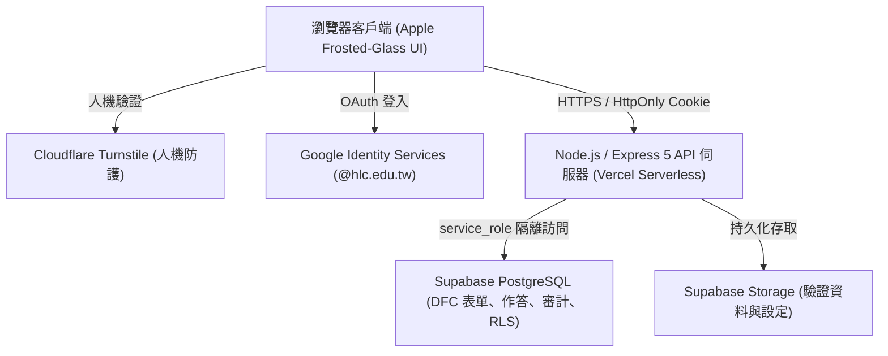

# KKNews 校園互動與 DFC 影音學習平台 🎓

[](https://nodejs.org/)
[](https://expressjs.com/)
[](https://supabase.com/)
[](https://vercel.com/)
[](LICENSE)

**KKNews** 是一個專為校園設計的高質感互動學習平台。結合花蓮縣教育處 Google 帳號認證（`@hlc.edu.tw`），提供**「諺語卡片即時排版工坊」**、**「DFC 沉浸式影音互動問答」**以及具備嚴密資安防護與分級授權的**「後台管理審計系統」**。

---

## 📑 目錄

- [✨ 核心特色](#-核心特色)
- [🧩 兩大核心功能模組](#-兩大核心功能模組)
  - [1. 諺語卡片工坊 (Proverb Studio)](#1-諺語卡片工坊-proverb-studio)
  - [2. DFC 沉浸式影音問答 (Design For Change)](#2-dfc-沉浸式影音問答-design-for-change)
- [🛡️ 系統資安與防護設計](#️-系統資安與防護設計)
- [🛠️ 技術棧架構](#️-技術棧架構)
- [📁 專案目錄結構](#-專案目錄結構)
- [🚀 快速開始 (Local Development)](#-快速開始-local-development)
  - [步驟 1：安裝依賴套件](#步驟-1安裝依賴套件)
  - [步驟 2：設定 Supabase 資料庫](#步驟-2設定-supabase-資料庫)
  - [步驟 3：產生密碼雜湊與金鑰](#步驟-3產生密碼雜湊與金鑰)
  - [步驟 4：配置環境變數 (.env)](#步驟-4配置環境變數-env)
  - [步驟 5：啟動伺服器](#步驟-5啟動伺服器)
- [🌐 部署指南 (Deployment)](#-部署指南-deployment)
- [⚙️ 管理後台與權限說明](#️-管理後台與權限說明)
- [📄 授權條款](#-授權條款)

---

## ✨ 核心特色

- **🍎 Apple 級磨砂液態玻璃質感介面**：採用 Modern Frosted-Glass 視覺風格、平滑滑動切換舞台（View Transition）、動態 Glider 導覽與高流暢度微互動。
- **🏫 學校網域身分驗證**：嚴格整合 Google OAuth 2.0，僅限 `@hlc.edu.tw` 網域帳號登入；資料庫層觸發器（Trigger）雙重把關。
- **🎨 HTML5 Canvas 即時高解析度繪圖**：支援 5 種卡片排版與多款經典色系，所見即所得，毫秒級即時繪製渲染。
- **🎬 創新 DFC 影音時間軸互動問卷**：串聯 Google Drive 串流與本機影片，時間點到達自動縮放畫面展開互動題庫，支援 6 種靈活題型。
- **🔒 隱蔽式後台與 RBAC 分級授權**：動態金鑰偽裝 404 入口、Super Admin（完整權限）與 Admin（唯讀審計）角色分離。
- **📊 系統服務監測儀表板**：動態觀測 Supabase 雲端資料庫連線狀態、API 延遲與全站統計指標。

---

## 🧩 兩大核心功能模組

### 1. 諺語卡片工坊 (Proverb Studio)
- **自由創作**：學生可輸入最多 100 字諺語心語及 30 字署名。
- **5 種版面風格**：
  - `經典居中`：對稱大器，經典排版。
  - `文青直排`：古樸典雅，直書意境。
  - `現代引言`：大引號雜誌感設計。
  - `典雅雙框`：藝廊裝裱風格雙重線條。
  - `潮流海報`：強烈左飾條社群感。
- **自訂主題配色**：經典米白、午夜深藍、森林綠、暖陽、以及自訂色票選取器。
- **匯出與下載**：支援單張高解析度 PNG 即時下載，後台更支援全校投稿**一鍵打包為 ZIP 壓縮檔**。

### 2. DFC 沉浸式影音問答 (Design For Change)
- **四步驟學習流程**：以 **感受 (Feel)**、**想像 (Imagine)**、**實踐 (Do)**、**分享 (Share)** 設計思維引導學生。
- **精準時間軸互動**：影片播放至設定時間點時，畫面平滑縮放至左側，右側動態展開作答表單，提交後自動繼續播放。
- **6 種題型完整支援**：
  1. 單選題（附選取微動效）
  2. 多選題（可複選）
  3. 1~5 星級評分題（Star Rating 評分回饋）
  4. 是非題（二擇一按鈕切換）
  5. 簡答／詳答題（字數統計）
  6. 下拉選單題
- **原生 Supabase 雲端資料庫儲存**：問卷問題題目、時間點標記、填答成果與深度行為數據均原生儲存於 Supabase 資料表（`public.dfc_forms` 與 `public.dfc_responses`），免 Google Form、免第三方外掛，後台一站式自主控管。
- **問卷工作室**：後台提供視覺化時間點調整、新增/複製問卷、CSV 題目匯入/匯出與前台主推問卷切換。

---

## 🛡️ 系統資安與防護設計

| 防護項目 | 實作策略與技術 |
| :--- | :--- |
| **網域限定** | 前端驗證 Google ID Token + 後端校驗 Hosted Domain (`hd: "hlc.edu.tw"`) + PostgreSQL 觸發器 `enforce_school_email` 強制拒絕非授權帳號。 |
| **資料庫隔離 (RLS)** | Supabase PostgreSQL 全表開啟強制 Row Level Security (RLS) 並撤銷 anon/authenticated 權限；全站資料存取皆透過後端 `service_role` 代理，瀏覽器絕不暴露資料庫憑證。 |
| **人機驗證與限流** | 整合 Cloudflare Turnstile 機器人防禦；採用分散式 Supabase Rate Limiter 針對 IP/Action 進行防刷保護（故障時自動平滑回退記憶體快取）。 |
| **密碼安全與防時序攻擊** | 管理員密碼採用 `scrypt` 結合高強度隨機 Salt 雜湊；校驗時使用 `crypto.timingSafeEqual` 杜絕時序攻擊（Timing Attacks）。 |
| **隱藏後台入口** | `/adminusercontrol?k=<ADMIN_ACCESS_KEY>`，若未提供或金鑰比對錯誤一律回應 HTTP 404 Not Found。 |
| **嚴格 CSP 防護** | 後端自動解析 HTML 並將內嵌 JavaScript 腳本拆分為外部獨立檔案，完全移除腳本的 `'unsafe-inline'`，並配置嚴格的 Content-Security-Policy。 |
| **全站安全審計 (Audit Logs)** | 結構化記錄所有使用者登入、作答歷程、IP 位址、裝置環境資訊與管理員後台操作軌跡。 |

---

## 🛠️ 技術棧架構



- **Runtime & 框架**：Node.js (CommonJS), Express.js 5.3+
- **資料庫與雲端服務**：Supabase (PostgreSQL 15+ & Storage)
- **前端核心**：純原生 JavaScript (Vanilla ES6+), HTML5 Canvas, CSS Variables, JSZip
- **外部整合**：Google OAuth 2.0 (@hlc.edu.tw), Cloudflare Turnstile, Google Drive Video Streaming

---

## 📁 專案目錄結構

```text
kknews/
├── api/
│   └── index.js             # Vercel Serverless Function 入口
├── views/
│   ├── index.html           # 前台首頁、諺語工坊、DFC 影音互動問卷與系統資訊
│   ├── admin.html           # 後台管理中心 (投稿管理、帳號清單、DFC工作室、審計數據)
│   ├── admin-login.html     # 管理員安全登入頁
│   ├── ui.css               # 全站 Apple Frosted-Glass 與自適應樣式表
│   └── icon.svg             # KKNews 向量徽標圖示
├── hash-password.js         # 管理員密碼加鹽雜湊與金鑰產生工具
├── server.js                # Express 核心伺服器（API 路由、安全驗證、中介軟體）
├── supabase.sql             # Supabase 資料表綱要、RLS 策略與資料庫指標函式
├── package.json             # 專案相依性配置
├── vercel.json              # Vercel 部署路由與靜態資源包含設定
└── .env.example             # 環境變數設定範本
```

---

## 🚀 快速開始 (Local Development)

### 步驟 1：安裝依賴套件

確認本機已安裝 Node.js 18 或以上版本，在專案根目錄執行：

```bash
npm install
```

### 步驟 2：設定 Supabase 資料庫

1. 前往 [Supabase Console](https://supabase.com/) 建立新專案。
2. 進入專案的 **SQL Editor**。
3. 開啟專案根目錄的 `supabase.sql`，將內容貼上並執行（可重複執行，已具備 `IF NOT EXISTS` 保護）。
4. 在專案 **Settings > API** 取得：
   - `Project URL` (`SUPABASE_URL`)
   - `service_role secret` (`SUPABASE_SERVICE_ROLE_KEY`)

### 步驟 3：產生密碼雜湊與金鑰

使用內建工具為管理員設定密碼：

```bash
node hash-password.js 你的自訂管理員密碼
```

終端機將會輸出以下三組設定值，請妥善複製：
- `ADMIN_PASSWORD_HASH`（密碼 scrypt 雜湊）
- `SESSION_SECRET`（Session 簽名密鑰）
- `ADMIN_ACCESS_KEY`（後台隱藏存取金鑰）

### 步驟 4：配置環境變數 (.env)

複製 `.env.example` 為 `.env`：

```bash
cp .env.example .env
```

編輯 `.env` 填入實際數值：

```env
# Supabase 連線資訊
SUPABASE_URL=https://your-project.supabase.co
SUPABASE_SERVICE_ROLE_KEY=your-service-role-key

# Google OAuth 憑證（限 @hlc.edu.tw 網域）
GOOGLE_CLIENT_ID=your-google-client-id.apps.googleusercontent.com
GOOGLE_FORM_API_KEY=your-google-form-api-key
GOOGLE_FORM_ACTION_URL=
GOOGLE_FORM_CSV_URL=

# 系統基底網址與管理員主帳號
BASE_URL=http://localhost:3000
ADMIN_EMAIL=admin@hlc.edu.tw

# 由 hash-password.js 產生填入
ADMIN_PASSWORD_HASH=salt:xxxxxxxxxxxxxxxxxxxxxxxxxxxxxxxx
SESSION_SECRET=xxxxxxxxxxxxxxxxxxxxxxxxxxxxxxxx
ADMIN_ACCESS_KEY=xxxxxxxxxxxxxxxxxxxxxxxx

# Cloudflare Turnstile 人機驗證金鑰
TURNSTILE_SECRET_KEY=your-turnstile-secret-key
```

### 步驟 5：啟動伺服器

執行以下指令啟動本機伺服器：

```bash
node server.js
```

伺服器預設將於 `http://localhost:3000` 啟動：
- 前台主頁：`http://localhost:3000/`
- 後台登入頁：`http://localhost:3000/adminusercontrol?k=<你的 ADMIN_ACCESS_KEY>`

---

## 🌐 部署指南 (Deployment)

### 部署至 Vercel (推薦)

專案已原生配置 `vercel.json` 與 `api/index.js`，可極速部署至 Vercel：

1. 將代碼推送至 GitHub 儲存庫。
2. 登入 [Vercel](https://vercel.com/) 並匯入此儲存庫。
3. 在 Vercel 專案設定中進入 **Settings > Environment Variables**，填入所有 `.env` 變數：
   - `SUPABASE_URL`
   - `SUPABASE_SERVICE_ROLE_KEY`
   - `GOOGLE_CLIENT_ID`
   - `ADMIN_EMAIL`
   - `ADMIN_PASSWORD_HASH`
   - `SESSION_SECRET`
   - `ADMIN_ACCESS_KEY`
   - `TURNSTILE_SECRET_KEY`
   - `BASE_URL`（設為 Vercel 派發的正式 Production 網址，如 `https://kknews.vercel.app`）
4. 點擊 **Deploy** 即可完成部署！

---

## ⚙️ 管理後台與權限說明

### 1. 後台安全入口
為防止爬蟲與暴力破解，管理入口設置了 URL 金鑰保護：
```text
https://your-domain.com/adminusercontrol?k=<ADMIN_ACCESS_KEY>
```
> [!IMPORTANT]
> 若訪問路徑未帶入正確的 `k` 參數，伺服器一律直接回傳 `404 Not Found`。

### 2. 管理員權限分級 (RBAC)
- **Super Admin（超級管理員）**：
  - 帳號由 `.env` 的 `ADMIN_EMAIL` 決定或由主管理員授權。
  - 具有全部權限：修改/刪除投稿、管理 DFC 問卷題目、切換主推活動、新增/刪除其他管理員帳號、匯出敏感資料。
- **Admin（一般管理員／審計唯讀）**：
  - 登入後頂部會顯示提示橫幅。
  - 僅具備資料查閱、即時搜尋、卡片預覽與 CSV 匯出權限，所有破壞性（POST/PATCH/DELETE）API 呼叫均會被後端拒絕（HTTP 403 Forbidden）。

---

## 📄 授權條款

本專案採用 [ISC License](LICENSE) 授權開放。
由 KKNews 專案開發小組維護，專為教育數位化學習與校園活動互動打造。
